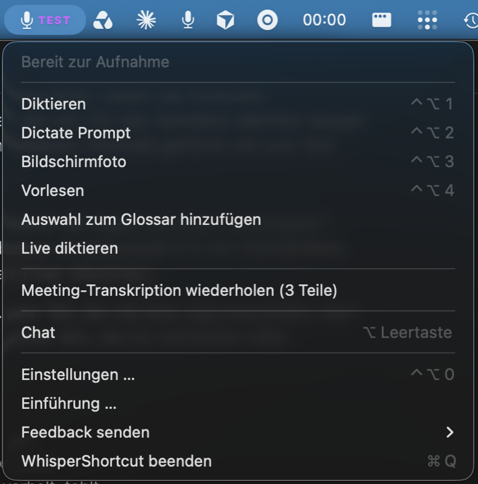

# Die macOS-App als Vorlage (Stand 03.11.2026, macOS v8.78)

Diese Datei beschreibt, **wie WhisperShortcut für macOS aufgebaut ist und sich verhält**: Menüleiste,
Kürzel, Abläufe, Meldungen, Einstellungen. Sie ist die Vorlage, wenn Windows etwas „wie auf dem Mac“
bauen soll. Unterschiede und Lücken stehen in [`macos-paritaet.md`](macos-paritaet.md), nicht hier.

**Erst die Quelle lesen, dann bauen.** Der Mac-Code liegt lokal unter
`~/whisper-shortcut-private/whisper-shortcut/WhisperShortcut/` (öffentlich:
[github.com/mgsgde/whisper-shortcut](https://github.com/mgsgde/whisper-shortcut)). Alle Pfade unten
sind relativ dazu. Diese Datei veraltet, der Code nicht: Wenn beide sich widersprechen, gilt der Code,
und diese Datei wird korrigiert.

- UI-Texte stehen hier im englischen Original (so findet man sie im Swift-Code). Die deutschen
  Fassungen stehen in `Localizable.xcstrings`, die Screenshots zeigen die deutsche Oberfläche.
- Screenshots: [`screenshots/macos/`](screenshots/macos/), Dev-Build v8.78, Dark Mode, deutsch.
- Was Windows bewusst anders macht, steht am Ende (Abschnitt 8).

## 1. Grundaufbau

- **Reine Menüleisten-App:** kein Dock-Symbol, kein Hauptfenster (`LSUIElement`). Alles läuft über das
  Menüleisten-Symbol, globale Kürzel und drei Fenster: **Einstellungen**, **Chat**, **Einführung** (Welcome).
- **Ein Zustandsautomat** (`AppState.swift:13-19, 300-341`):
  `idle → recording(mode) → processing(mode) → feedback(success|error) → idle`; dazu `speaking`
  fürs Vorlesen. „Beschäftigt“ heißt nur recording oder processing; während `speaking` darf eine neue
  Aufnahme starten.
- **Jedes Kürzel ist ein Umschalter:** einmal drücken startet, noch einmal stoppt. Halten zum Sprechen
  gibt es absichtlich nicht (`Shortcuts.swift:28-31`). Drückt man das Kürzel während der Verarbeitung,
  bricht das den Lauf ab (`MenuBarController.swift:1586-1602`).
- **Das Ergebnis landet immer in der Zwischenablage.** Automatisch einfügen ist ein Schalter und
  standardmäßig **aus**.
- **Aufnahmeanzeige („Pill“):** unten in der Mitte, zeigt den Zustand („Listening“, „Prompting“,
  „Thinking“) und ein ✕ zum Verwerfen.

## 2. Menüleiste

**Symbol je Zustand** (`AppState.swift:190-238`, `MenuBarController.swift:1187-1204`):

| Zustand | Symbol | Statuszeile im Menü |
|---|---|---|
| idle | `mic.fill` (Template, 14 pt) | „Ready to record“ |
| Diktat läuft | 🔴 | „🔴 Dictating...“ |
| Dictate Prompt läuft | 🤖 | „🔴 Recording Dictate Prompt...“ |
| Meeting läuft | 📝 | „📝 Live transcription...“ |
| Verarbeitung | ⏳, blinkt (Alpha 1,0 ↔ 0,35 alle 0,5 s) | „⏳ Transcribing audio...“, „⏳ Processing Dictate Prompt...“, „⏳ Preparing Read Aloud...“, „⏳ {a} processing, {d}/{n} done“ |
| Stücke schneiden / zusammenführen | ✂️ / 🔗 | „✂️ Splitting audio into chunks...“, „🔗 Merging transcription...“ |
| Vorlesen | 🔊 | „🔊 Speaking...“ |
| Erfolg / Fehler | ✅ 2 s / ❌ 3 s, dann idle | „✅ …“ / „❌ …“ |
| nichts eingerichtet | ⚠️ | Tooltip „Add an API key or use an offline model - click to configure“ |

**Menüeinträge in dieser Reihenfolge** (`MenuBarController.swift:465-597`). Kursiv = erscheint nur bei Bedarf.

1. Statuszeile (nicht klickbar)
2. *„Finish setup…“*, solange die Einführung nicht fertig ist
3. *„Review {n} Changes from AI Apps…“*, wenn KI-Apps Änderungen vorschlagen
4. *„Stop“*, während etwas läuft
5. „Dictate“ ⌃⌥1 (heißt während der Aufnahme „Stop Dictate“)
6. „Dictate Prompt“ ⌃⌥2 (→ „Stop Dictate Prompt“)
7. „Screenshot“ ⌃⌥3
8. „Read Aloud“ ⌃⌥4 (→ „Stop Read Aloud“)
9. „Add Selection to Glossary“
10. „Dictate Live“
11. *„Copy Last Transcription“*, sobald es einen Verlauf gibt; Meldung „Transcription copied — press ⌘V to paste“
12. *„Recent Transcriptions ▸“*, ab 2 Einträgen; höchstens 5, je auf 44 Zeichen + „…“ gekürzt
13. *„Transcribe Cancelled Recording“*, solange eine abgebrochene Aufnahme aufbewahrt ist (nur eine)
14. *„Run Again Without Template“*, 10 Minuten nach einem Vorlagen-Diktat
15. *„Retry Meeting Transcription ({n} parts)“*; mit gehaltenem ⌥ stattdessen „Show Untranscribed Meeting Audio“
16. „Chat“ ⌥Leertaste
17. „Settings…“ ⌃⌥0
18. „Welcome Tour…“
19. „Send Feedback ▸“: „Report a Problem with Last Dictation…“, „WhatsApp“, „Email“, „GitHub Issue“
20. „Quit WhisperShortcut“ ⌘Q

## 3. Kürzel (`ShortcutConfig.swift:251-266`)

| Aktion | Standard (Neuinstallation) |
|---|---|
| Diktieren | ⌃⌥1 |
| Dictate Prompt | ⌃⌥2 |
| Bildschirmfoto | ⌃⌥3 |
| Vorlesen | ⌃⌥4 |
| Live diktieren | ⌃⌥5, aus |
| Ins Glossar | ⌃⌥7, aus |
| Chat öffnen/schließen | ⌥Leertaste |
| Einstellungen | ⌃⌥0 |

- **Ältere Installationen** behalten ⌘1–⌘4 und ⌘0.
- **Fn (🌐):** ein zusätzlicher Umschalter fürs Diktat. Er wird beim *Loslassen* ausgewertet, und ein
  zweiter Druck innerhalb von 2 s nach dem Start bricht nicht ab (`FnDictationToggle.swift:25-40, 83`).
  Braucht die Bedienungshilfen-Berechtigung.

## 4. Abläufe

### Diktieren

1. **Start:** Das Kürzel öffnet vorab die Verbindung und startet die Aufnahme in Stücken
   (24 kHz PCM, `ChunkedDictateRecorder.swift`). Die Pill zeigt „Listening“.
2. **Keine Höchstlänge** („deliberately no max-duration cut“).
3. **Stücke schon beim Sprechen:** Ein Stück wird geschnitten, sobald es mindestens 10 s lang ist und
   1,0 s Stille unter −45 dB folgt. Es wird sofort transkribiert (`AppConstants.swift:299-305`).
4. **Stopp:** wartet 0,2 s Nachlauf fürs letzte Wort, außer das Ende war schon still
   (`MenuBarController.swift:12, 1433-1452`).
5. **Stille Aufnahme:** Hinweis „Didn't catch that“ / „Nothing to transcribe. Check the microphone and
   try again.“ für 4 s.
6. **Lange Aufnahme:** ab 5 min (einstellbar; bei Offline-Modellen nie) erscheint der Dialog
   „Long recording“ / „This recording is {t} long. Process anyway? (API usage may incur costs.)“ mit
   [Process] [Cancel]. Bei Cancel bleibt das Audio für „Transcribe Cancelled Recording“ erhalten.
7. **Verarbeitung:** Gibt es ein gestreamtes Transkript, wird es verwendet. Sonst wird die ganze Datei
   transkribiert, über 45 s in 45-s-Stücken mit 2 s Überlappung. Das ist auch der Weg, wenn ein Stück
   scheitert.
8. **Retries:** je Stück bis zu 5 Versuche im Abstand von 1,5 s. Gemini-Anfragen bekommen 5 Versuche,
   bei Serverfehlern 6, und die Wartezeit aus `RetryInfo` wird eingehalten.
9. **Standardmodell:** GPT Transcribe, Temperatur 0, Thinking „minimal“.
10. **Ergebnis:**
    - Text in die Zwischenablage; bei „Automatic punctuation“ wird ein Schlusspunkt ergänzt.
    - Bei Automatisch einfügen: 150 ms warten, dann ⌘V, **nur in die App, die beim Start vorne war**
      (`PasteTargetPolicy.swift`).
    - Ist eine andere App vorne, bleibt der Text in der Zwischenablage: Popup „Text Copied to Clipboard“
      mit „Copied – press ⌘V to paste“. Nach erfolgreichem Einfügen blendet die Pill nur aus.
11. **Zwischenablage danach** (Einstellung): Diktat stehen lassen (Standard), vorherigen Inhalt nach 3 s
    zurücklegen, oder leeren. Gesichert werden alle Typen, nicht nur Text.
12. **Verlauf:** Jedes Ergebnis kommt in „Copy Last“ / „Recent“.
13. **Abbrechen:** mit dem Kürzel, Stop oder dem ✕ der Pill. Das Audio bleibt für „Transcribe Cancelled
    Recording“ erhalten.
14. **Fehler:** Fehler, die sich wiederholen lassen, bekommen einen Retry-Knopf; bei Serverfehlern
    wartet der Retry 3 s.

### Dictate Prompt (markierten Text per Sprache bearbeiten)

1. **Markierung holen:** Zwischenablage sichern, ⌘C senden (eigene Event-Quelle, damit gehaltene Tasten
   nicht mitgehen), dann 0,5 s lang alle 15 ms prüfen, ob sich die Zwischenablage geändert hat
   (`MenuBarController.swift:3509-3570`, `DictatePromptSelection.swift`).
   - Neue Zwischenablage mit Text → **Bearbeiten**: die Anweisung wird auf diesen Text angewendet.
   - Sonst → **Verfassen**: neuer Text an der Cursorposition.
2. **Aufnahme:** Die Pill zeigt „Prompting“ und darüber die **Schnell-Prompts** (⌃1–9 oder klicken
   statt sprechen). Prompt-Aufnahmen werden nicht gestreamt.
3. **Bildschirminhalt:** Standardmäßig geht ein Screenshot mit (Schalter; braucht Bildschirmaufnahme).
4. **Verarbeitung:** Pill „Thinking“, Standardmodell Gemini 3.8 Flash.
   **Gesprächsgedächtnis:** die letzten 5 Runden gehen mit, gelöscht nach 5 min Pause
   (`AppConstants.swift:318-322`). So versteht „jetzt noch kürzer“ den Bezug.
5. **Ergebnis:** wie beim Diktat (Zwischenablage, optional einfügen). Status „AI response copied to
   clipboard“.

### Offline

- **Modelle:** Whisper Tiny, Base, Small, Large v3 Turbo (Medium und Large nur, wenn schon geladen) und
  Parakeet Ultra (empfohlen) (`ModelManager.swift:24-33`).
- **Ablauf:** Jedes Modell wird einmal geladen und bleibt gespeichert. Es gibt keine
  Kostenabfrage. Fehlt das Modell: „📥 Model Not Downloaded“.
- **Satzzeichen:** „Automatic“ oder „Only when spoken“; gesprochene Satzzeichen werden umgesetzt.
- **Dictate Live:** Der Text erscheint nach jeder Pause am Cursor, offline mit Parakeet Ultra.
  Ist am Ende eine andere App vorne: „The end of the dictation was not inserted because another app was
  in front. It is on the clipboard.“

### Vorlesen

1. **Markierung holen** wie bei Dictate Prompt. Ohne Markierung: „No text selected. Highlight text
   first, then press the Read Aloud shortcut.“
2. **Umschreiben:** Mit „Intelligentes Umschreiben“ (Standard an) macht das Chat-Modell den Text
   vorher sprechbar.
3. **Synthese:** in Stücken, das erste mit 120 Zeichen für einen schnellen Start, danach bis zu 500
   (Gemini 260).
4. **Wiedergabe:** Die Pill hat Stop, Pause, ±10 s, Fortschritt und Tempo. Das Kürzel stoppt.

### Bildschirmfoto

Interaktive Auswahl (`screencapture -i`); ein Klick ohne Ziehen nimmt den ganzen Bildschirm. Das Bild
kommt in die Zwischenablage, optional auch als PNG in einen Ordner. Der Zustandsautomat ändert sich
dabei nicht.

### Meeting

1. **Start** aus dem Chat mit `/meeting`. Es gibt keinen Menüeintrag dafür.
2. **Transkription:** Stücke ab 10 s, sobald 1,5 s unter −40 dB folgen, höchstens 60 s (einstellbar).
   Ist der Chat sichtbar, sind es 6–12 s.
3. **Nach 90 min** fragt die App: „Long meeting“ mit [Stop meeting] [Continue].
4. **Am Ende** entstehen Transkript, Notizen und Zusammenfassung.
5. **Fehlgeschlagene Teile:** Ihr Audio bleibt für „Retry Meeting Transcription“ erhalten.
6. **Diktat während des Meetings:** Diktieren und Dictate Prompt laufen weiter, während das Meeting
   aufnimmt.

## 5. Meldungen (Auswahl, Texte exakt)

**Popups:**
- erscheinen unten in der Mitte;
- Erfolg bleibt 3 s, Fehler 30 s; ein Fehler mit Aktionsknopf bleibt stehen;
- jeder Fehler hat „Contact Support“, je nach Fall auch Retry, Sign in oder Top up
  (`PopupNotificationWindow.swift`).

| Art | Text | Quelle |
|---|---|---|
| Blockiert | „Busy – wait for the current run to finish.“ | `MenuBarController.swift:1558` |
| Blockiert | „API Key Required“ | `:1566-1574` |
| Berechtigung | „Microphone Access Needed“ [Open System Settings] | `:4327-4332` |
| Berechtigung | „Screen Recording Permission Needed“ [Review Permissions] | `:4590-4597` |
| Berechtigung | „Enable Accessibility for Auto-Paste“ [Open System Settings] [Copy Reset Command] [Not Now] | `AccessibilityPermissionManager.swift:31-46` |
| Kein Ergebnis | „Didn't catch that“ / „Nothing to transcribe. Check the microphone and try again.“ | `MenuBarController.swift:2288` |
| Fehlertitel | „⚠️ No Google API Key“, „❌ Invalid API Key“, „❌ Country Not Supported“, „⏳ Rate Limited“, „⏳ Quota Exceeded“, „💳 Billing Required“, „⏰ Network Error“, „⏰ Request Timeout“, „❌ Server Error“, „🔄 Service Unavailable“, „❌ File Too Large“, „🎤 No Speech“, „📥 Model Not Downloaded“, „❌ Model no longer available“, „📝 Nothing Selected“ | `SpeechErrorFormatter.swift:416-465` (Langtexte `:12-412`) |
| Hinweise | „Not in your dictation“ (Offline-Wortprüfung), „Reply may be cut off“ | `PopupNotificationWindow.swift:990-1031` |
| Fortschritt | „Retrying chunk {n}...“, „Merging transcription results...“ | `MenuBarController.swift:4948, 4983` |

## 6. Einstellungsfenster

- **Fenster:** Titel „Settings“, 1100×800 bevorzugt (75 % × 85 % des Bildschirms, min 800×600, max
  1200×1000), mittig (`SettingsWindowController.swift`).
- **Aufbau:** Links eine flache Seitenleiste (270 breit, Symbol + Titel, keine Gruppen), rechts der
  scrollende Inhalt. Unten rechts fest „Version X“.
- **Merken:** Der zuletzt gewählte Tab wird gespeichert.
- **Abschnitte:** Jeder hat Symbol + Überschrift + einen Satz Untertitel; Schalter haben eine kleine
  Erklärzeile darunter.
- **„Advanced“:** Selten Gebrauchtes steckt am Tab-Ende in einer eingeklappten Gruppe
  (`Components/AdvancedSettingsGroup.swift`).
- **Speichern:** Es gibt keinen Speichern-Knopf; alles wirkt sofort. API-Schlüssel werden 500 ms nach
  dem letzten Tastendruck gespeichert, im Schlüsselbund.

| # | Tab (dt.) | Inhalt | Quelle | Screenshot |
|---|---|---|---|---|
| 1 | Allgemein | Kürzel, Fn, Start bei Anmeldung, Sprache, Popups, Zwischenablage | `Settings/Tabs/GeneralSettingsTab.swift` | [01](screenshots/macos/einstellungen-01-allgemein.png) |
| 2 | Konten | ChatGPT, OpenRouter, API-Schlüssel, verbundene Dienste | `AccountsSettingsTab.swift` | [02](screenshots/macos/einstellungen-02-konten.png) |
| 3 | Diktieren | Modus, Modell, Offline-Modelle, Sprache, Satzzeichen, Glossar, System-Prompt | `SpeechToTextSettingsTab.swift` | [03](screenshots/macos/einstellungen-03-diktieren.png) |
| 4 | Dictate Prompt | Modell, Bildschirminhalt, Schnell-Prompts, Nachschlagen, System-Prompt | `SpeechToPromptSettingsTab.swift` | [04](screenshots/macos/einstellungen-04-dictate-prompt.png) |
| 5 | Vorlagen | feste Formate (z. B. Behandlungsnotiz), eigenes Kürzel | `TemplatesSettingsTab.swift` | [05](screenshots/macos/einstellungen-05-vorlagen.png) |
| 6 | Bildschirmfoto | in Ordner speichern | `ScreenshotSettingsTab.swift` | [06](screenshots/macos/einstellungen-06-bildschirmfoto.png) |
| 7 | Vorlesen | Modell, Stimme, Tempo, Umschreiben | `ReadAloudSettingsTab.swift` | [07](screenshots/macos/einstellungen-07-vorlesen.png) |
| 8 | Chat | Modell, Websuche, System-Prompt, Befehle, Gedächtnis, Ordner | `ChatSettingsTab.swift` | [08](screenshots/macos/einstellungen-08-chat.png) |
| 9 | Meetings | Modelle für Transkript und Zusammenfassung, Intervall | `MeetingsSettingsTab.swift` | [09](screenshots/macos/einstellungen-09-meetings.png) |
| 10 | Smart Improvement | aus Nutzung lernen, Schreibstil | `ImprovementSettingsTab.swift` | [10](screenshots/macos/einstellungen-10-smart-improvement.png) |
| 11 | Claude & KI-Apps | MCP-Server, Zugriffsstufe, Einrichtung für Claude Code / Desktop / Codex | `AIAppsSettingsTab.swift` | [11](screenshots/macos/einstellungen-11-ki-apps.png) |
| 12 | Datenschutz & Berechtigungen | Offline-Modus, Nutzungsstatistik, Berechtigungen | `PrivacyPermissionsTab.swift` | [12](screenshots/macos/einstellungen-12-datenschutz.png) |
| 13 | Über | Updates, Einführung, Datenschutz, Zurücksetzen, Support | `AboutSettingsTab.swift` | [13](screenshots/macos/einstellungen-13-ueber.png) |

### Die Tabs, die Windows betreffen, im Detail

**Allgemein**
- **Kürzel:** Jede Zeile hat Feld, „Record“ und ✕ („Clear shortcut“). Bei einem Konflikt erscheinen
  „Reassign“ / „Cancel“.
- **„Also dictate with 🌐 Fn“:** Erklärzeile „Press Fn once to start, again to stop. Needs
  Accessibility.“ Fehlt die Berechtigung, steht darunter eine Warnung mit „Allow Accessibility“.
- **„Launch at Login“:** aus.
- **„Show Notifications“:** an.
- **„Auto-paste“:** aus. Erklärzeile „Pastes the result at the cursor (⌘V). Needs Accessibility
  permission.“
- **„After auto-paste“:** gesperrt, solange Auto-paste aus ist.

  | Option | Erklärzeile |
  |---|---|
  | „Leave dictation“ (Standard) | „The dictated text stays on the clipboard, so you can paste it again with ⌘V.“ |
  | „Restore previous“ | „Puts back what you had copied before, right after pasting.“ |
  | „Empty it“ | „Empties the clipboard after pasting, so a later ⌘V cannot paste an earlier dictation. Copy Last Transcription still works.“ |

- **Advanced:**
  - Popup-Position, Standard „Center bottom“;
  - Popup-Dauer 1–30 s, Standard 3 s „(Recommended)“;
  - „Ask when recording longer than“: Never / 1 / 2 / 5 (Standard) / 10 min.

**Konten**
- **Oberer Block** „AI PROVIDERS“, Untertitel: „Connect at least one. Every feature then lets you pick a
  model from the providers connected here. Offline models need none of this.“
- **Schlüssel-Abschnitte:** einer je Anbieter (Google `AIza...`, OpenAI `sk-...`, Anthropic `sk-ant-...`,
  xAI `xai-...`). Jeder hat ein verdecktes Feld mit Auge, ein Status-Badge („Verbunden“ / „Wird
  geprüft …“) und darunter den Link, wo man den Schlüssel bekommt.
- **Unterer Block** „CONNECTED SERVICES“: Google-Konto, Trello, Mail (IMAP).

**Diktieren**
1. **Modus:** „Dictate“ / „Dictate Live“.
2. **Modellwahl** (siehe unten).
3. **Offline-Modelle:** Liste mit Laden / Abbrechen / Löschen, Größe und Status („Geladen“ /
   „Nicht geladen“).
4. **Sprache:** nur bei Nicht-Gemini-Modellen; „Auto-detect“ plus 23 Sprachen.
5. **Satzzeichen:** nur offline.
6. **Glossar und System-Prompt:** Editoren mit „Revert“, „Open file“, „Reset to default“ und
   „Saved“/„Not saved“. Ignoriert das Modell den System-Prompt (GPT Transcribe, offline), steht das
   Glossar oben und der Prompt eingeklappt mit Warnung.
7. **Advanced:** Temperatur (Standard 0,0 „verbatim“) und Thinking (Standard Minimal), nur bei Gemini.

**Dictate Prompt**
1. **Modell.**
2. **Schalter „Include screenshot“:** an.
3. **Schnell-Prompts:** Zeilen mit Textfeld, ⌃N-Label, hoch/entfernen; „Add Prompt“, „Start from
   Current List“. Schalter „Also show prompts you use often“: an.
4. **„Let Dictate Prompt use read-only tools“:** an.
5. **System-Prompt.**

**Modellwahl (überall gleich, `Settings/Shared/ModelPickerCuration.swift`)**
- **Oben bis zu drei Kacheln:** „Recommended“ ★, „Fastest“ ⚡, „Offline“ 🖥. Alles andere steckt hinter
  „More models (n)“, gruppiert nach Anbieter.
- **Fehlt etwas:** Kacheln ohne Schlüssel tragen „Needs key“.
- **Darunter:** eine Zeile mit Beschreibung des gewählten Modells und „Cost: …“.

| Modus | Standard |
|---|---|
| Diktieren, Meeting-Transkript | GPT Transcribe |
| Dictate Prompt, Chat, Smart Improvement | Gemini 3.8 Flash |
| Vorlesen | Gemini 3.8 Flash-Lite TTS |
| Meeting-Zusammenfassung | Gemini 3.5 Flash-Lite |

Die vollständigen Modelllisten stehen im Code (`TranscriptionModels.swift`,
`Settings/Shared/SettingsConfiguration.swift`). Nicht hierher kopieren, sie ändern sich jede Woche.

**Zurücksetzen** (Über → „Reset all to defaults“):
- Dialog „Reset app to default?“ mit [Reset and quit app] [Cancel].
- Gelöscht werden Einstellungen, Prompts, Chats, Meetings und Nutzungsdaten. API-Schlüssel bleiben.

## 7. Einführung (erster Start)

- **Wann:** öffnet beim Start, solange `hasCompletedOnboarding` falsch ist. Schließen gilt nicht als
  fertig: Beim nächsten Start geht es beim gespeicherten Schritt weiter.
- **Schritte** (`Onboarding/WelcomeSteps.swift`):

  | Schritt | Inhalt |
  |---|---|
  | Intro | „Welcome to WhisperShortcut“ / „Turn your voice into text in any app.“ |
  | Einrichtung | „How should dictation run?“, zwei Karten: **Offline** (Modell laden, Schalter Offline-Modus) und **Cloud** (OpenRouter verbinden, Google-Schlüssel; OpenAI, Anthropic, xAI eingeklappt) |
  | Berechtigungen | Mikrofon (Pflicht), Bildschirmaufnahme (optional), Bedienungshilfen mit Fn und Auto-paste |
  | Ausprobieren | „Try it now“, erstes Diktat |
  | Fertig | Kürzelliste; „You can revisit this tour any time from Settings → About.“ |

- **Danach:** Ist die Einführung fertig, aber keine Transkription eingerichtet, öffnen die
  Einstellungen auf „Konten“.

## 8. Was Windows bewusst anders macht

Nicht „angleichen“, ohne Magnus zu fragen:

- **Oberfläche** ist deutsch, nicht englisch mit Übersetzung.
- **Kürzel:** Strg/Alt/Umschalt statt ⌃⌥⌘, Fn gibt es nicht. Die Windows-Belegung steht in
  `src/WhisperShortcut/HotkeyService.cs`.
- **Tray-Symbol** statt Menüleiste, Rechtsklick-Menü statt Klick. Reihenfolge und Wortlaut der Einträge
  folgen trotzdem Abschnitt 2, soweit es die Funktion auf Windows gibt.
- **Wo Windows besser ist:** Abschnitt D in [`macos-paritaet.md`](macos-paritaet.md) (Mikrofonwahl mit
  Pegel, Admin-Fenster-Erkennung, Diktate nicht im Win+V-Verlauf …). Das bleibt.
- **Bewusst noch nicht da:** Was Windows absichtlich nicht hat (Chat, Smart Improvement, Schreibstil,
  weitere Anbieter), steht in Abschnitt C der Paritätsliste.

## Aktualisieren

- **Wann:** bei jeder größeren Mac-Änderung an Menü, Kürzeln, Abläufen oder Einstellungen. Stand-Version
  oben anpassen.
- **Screenshots neu:** mit dem Treiber im Mac-Repo, deutsch und als Sidecar. Die Anleitung steht in
  `whisper-shortcut/.agents/skills/run-whisper-shortcut/SKILL.md`. Die Tabs lassen sich per
  Accessibility wählen (`set selected of row N of outline 1 …`).
- **Datenschutz:** Das Repo ist **öffentlich**. Vor dem Commit jeden Screenshot auf persönliche Daten
  prüfen: Schlüssel, Namen, Meeting-Titel, die Liste „Von KI-Apps geändert“.
